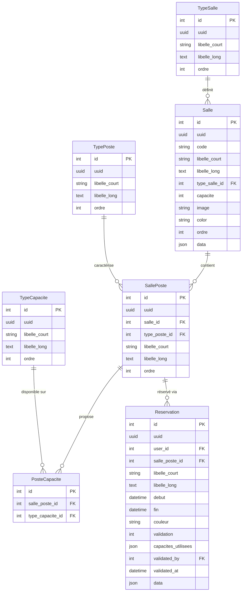

# Schéma base de données

## Architecture générale

```
TypeSalle ──→ Salle ──→ SallePoste ←── TypePoste
                             │
                        PosteCapacite ←── TypeCapacite
                             │
                        Reservation ←── User
```

---

## Diagramme ERD



---

## Description des tables

### `resa_type_salles`

Référentiel des types de salles.

| Colonne | Type | Nullable | Description |
|---|---|---|---|
| `id` | int PK | non | Identifiant |
| `uuid` | uuid | non | UUID unique |
| `libelle_court` | string(500) | oui | Nom affiché (ex. "Simulateur drone") |
| `libelle_long` | text | oui | Description complète |
| `ordre` | int | non | Ordre d'affichage (défaut 0) |
| `created_at` / `updated_at` | datetime | — | Timestamps Laravel |

---

### `resa_salles`

Salles physiques rattachées à un type.

| Colonne | Type | Nullable | Description |
|---|---|---|---|
| `id` | int PK | non | Identifiant |
| `uuid` | uuid | non | UUID unique |
| `code` | string | oui | Code interne |
| `libelle_court` | string(500) | oui | Nom affiché |
| `libelle_long` | text | oui | Description |
| `type_salle_id` | int FK | non | → `resa_type_salles` (`restrictOnDelete`) |
| `capacite` | int | oui | Capacité max (nombre de postes) |
| `image` | string | oui | Chemin image (`storage/resa/salles/`) |
| `color` | string | oui | Couleur d'affichage Filament |
| `ordre` | int | non | Ordre d'affichage (défaut 0) |
| `data` | json | oui | Données libres extensibles |
| `created_at` / `updated_at` | datetime | — | Timestamps Laravel |

---

### `resa_type_postes`

Référentiel des types de postes.

| Colonne | Type | Nullable | Description |
|---|---|---|---|
| `id` | int PK | non | Identifiant |
| `uuid` | uuid | non | UUID unique |
| `libelle_court` | string(500) | oui | Nom du type (ex. "PC Drone") |
| `libelle_long` | text | oui | Description |
| `ordre` | int | non | Ordre d'affichage (défaut 0) |
| `created_at` / `updated_at` | datetime | — | Timestamps Laravel |

---

### `resa_salle_postes`

Table pivot **many-to-many** `Salle` ↔ `TypePoste`. Chaque ligne représente un poste physique dans une salle.

| Colonne | Type | Nullable | Description |
|---|---|---|---|
| `id` | int PK | non | Identifiant |
| `uuid` | uuid | non | UUID unique |
| `salle_id` | int FK | non | → `resa_salles` (`cascadeOnDelete`) |
| `type_poste_id` | int FK | non | → `resa_type_postes` (`restrictOnDelete`) |
| `libelle_court` | string(500) | oui | Nom affiché du poste (ex. "Poste 1") |
| `libelle_long` | text | oui | Description |
| `ordre` | int | non | Ordre d'affichage / colonne calendrier |
| `created_at` / `updated_at` | datetime | — | Timestamps Laravel |

!!! info "Colonne calendrier"
    Le champ `ordre` détermine l'ordre des colonnes dans le calendrier Guava. Poste avec `ordre = 1` = première colonne.

---

### `resa_type_capacites`

Référentiel des capacités disponibles sur les postes (ex. FPV, 20mm, Bob).

| Colonne | Type | Nullable | Description |
|---|---|---|---|
| `id` | int PK | non | Identifiant |
| `uuid` | uuid | non | UUID unique |
| `libelle_court` | string(500) | oui | Nom affiché (ex. "FPV") |
| `libelle_long` | text | oui | Description |
| `ordre` | int | non | Ordre d'affichage (défaut 0) |
| `created_at` / `updated_at` | datetime | — | Timestamps Laravel |

---

### `resa_poste_capacites`

Table pivot **many-to-many** `SallePoste` ↔ `TypeCapacite`.  
Déclare quelles capacités sont **disponibles** sur chaque poste.

| Colonne | Type | Nullable | Description |
|---|---|---|---|
| `id` | int PK | non | Identifiant |
| `salle_poste_id` | int FK | non | → `resa_salle_postes` (`cascadeOnDelete`) |
| `type_capacite_id` | int FK | non | → `resa_type_capacites` (`restrictOnDelete`) |

!!! warning "Distinction importante"
    `resa_poste_capacites` = capacités **disponibles** sur le poste (configuration).
    `capacites_utilisees` sur `Reservation` = capacités **choisies** par l'user lors de sa réservation (traçabilité).

---

### `resa_reservations`

Une réservation = un utilisateur + un poste + un créneau.

| Colonne | Type | Nullable | Description |
|---|---|---|---|
| `id` | int PK | non | Identifiant |
| `uuid` | uuid | non | UUID unique |
| `user_id` | int FK | non | → `users` (`restrictOnDelete`) |
| `salle_poste_id` | int FK | non | → `resa_salle_postes` (`restrictOnDelete`) |
| `libelle_court` | string(500) | oui | Intitulé de la réservation |
| `libelle_long` | text | oui | Informations complémentaires |
| `debut` | datetime | non | Début du créneau |
| `fin` | datetime | non | Fin du créneau |
| `couleur` | string | oui | Couleur d'affichage calendrier |
| `validation` | int | non | `0` = en attente · `1` = validé |
| `capacites_utilisees` | json | oui | IDs des capacités choisies par l'user |
| `validated_by` | int FK | oui | → `users` — admin ayant validé (`nullOnDelete`) |
| `validated_at` | datetime | oui | Date de validation |
| `data` | json | oui | Données libres extensibles |
| `created_at` / `updated_at` | datetime | — | Timestamps Laravel |

**Index :**

```sql
INDEX (salle_poste_id, debut, fin)   -- vérification chevauchement
INDEX (user_id, validation)          -- filtrage par user et statut
```

---

## Exemple de configuration — Salle 1

### Postes et capacités

| Poste | `ordre` | Capacités disponibles |
|---|---|---|
| Poste 1 | 1 | FPV, 20mm |
| Poste 2 | 2 | FPV |
| Poste 3 | 3 | 20mm |
| Poste 4 | 4 | FPV, 20mm, Bob |

### Exemple de réservation

```json
{
  "user_id": 12,
  "salle_poste_id": 1,
  "libelle_court": "Entraînement drone",
  "debut": "2026-04-22 09:00:00",
  "fin": "2026-04-22 11:00:00",
  "validation": 0,
  "capacites_utilisees": [1, 2]
}
```

---

## Relations Eloquent

| Relation | Type | Description |
|---|---|---|
| `TypeSalle` → `Salle` | hasMany | Un type couvre plusieurs salles |
| `Salle` → `TypeSalle` | belongsTo | Une salle a un type |
| `Salle` → `SallePoste` | hasMany | Une salle a plusieurs postes |
| `SallePoste` → `Salle` | belongsTo | Un poste appartient à une salle |
| `SallePoste` → `TypePoste` | belongsTo | Un poste a un type |
| `SallePoste` ↔ `TypeCapacite` | belongsToMany | Via `resa_poste_capacites` |
| `SallePoste` → `Reservation` | hasMany | Un poste a plusieurs réservations |
| `Reservation` → `SallePoste` | belongsTo | Une réservation pointe vers un poste |
| `Reservation` → `User` | belongsTo | Demandeur |
| `Reservation` → `User` | belongsTo (`validated_by`) | Admin validateur |

---

## Règles de cohérence

| Règle | Description |
|---|---|
| Pas de chevauchement | `(salle_poste_id, debut, fin)` — vérifié avant insertion |
| `validation` | Valeurs `0` ou `1` uniquement |
| `capacites_utilisees` | Tableau JSON d'IDs de `TypeCapacite` — peut être vide ou null |
| FK `restrictOnDelete` | Impossible de supprimer un type si des salles/postes l'utilisent |
| FK `cascadeOnDelete` | Supprimer une salle supprime ses postes · Supprimer un poste supprime ses liaisons capacités |
