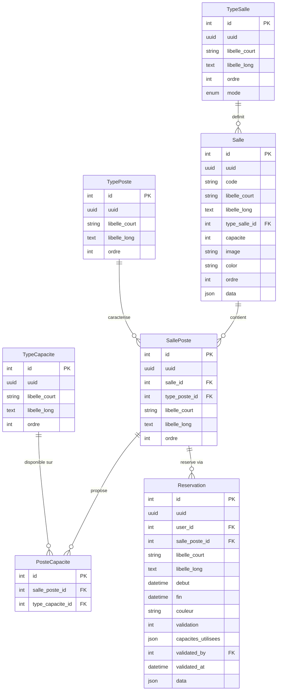

# Schema base de donnees

## Architecture generale

```
TypeSalle (mode: simulateur|classique)
    └── Salle
          └── SallePoste ←── TypePoste
                    │
               PosteCapacite ←── TypeCapacite
                    │
               Reservation ←── User
```

---

## Diagramme ERD



---

## Description des tables

### `resa_type_salles`

Referentiel des types de salles.

| Colonne | Type | Nullable | Description |
|---|---|---|---|
| `id` | int PK | non | Identifiant |
| `uuid` | uuid | non | UUID unique |
| `libelle_court` | string(500) | oui | Nom affiche (ex. "Simulateur drone") |
| `libelle_long` | text | oui | Description complete |
| `ordre` | int | non | Ordre d'affichage (defaut 0) |
| `mode` | enum | non | `simulateur` ou `classique` |
| `created_at` / `updated_at` | datetime | — | Timestamps Laravel |

**Constantes du model :**

```php
TypeSalle::MODE_SIMULATEUR = 'simulateur'
TypeSalle::MODE_CLASSIQUE  = 'classique'
```

**Mode simulateur** : salles avec postes individuels, scoring par capacites, Wizard 3 etapes, colonnes dans le calendrier.

**Mode classique** : reservation de la salle entiere, Wizard 2 etapes, pas de colonnes. Un poste fictif "Salle entiere" est cree automatiquement par le seeder.

---

### `resa_salles`

Salles physiques rattachees a un type.

| Colonne | Type | Nullable | Description |
|---|---|---|---|
| `id` | int PK | non | Identifiant |
| `uuid` | uuid | non | UUID unique |
| `code` | string | oui | Code interne |
| `libelle_court` | string(500) | oui | Nom affiche |
| `libelle_long` | text | oui | Description |
| `type_salle_id` | int FK | non | → `resa_type_salles` (`restrictOnDelete`) |
| `capacite` | int | oui | Capacite max (personnes) — indicatif pour le mode classique |
| `image` | string | oui | Chemin image (`storage/resa/salles/`) |
| `color` | string | oui | Couleur d'affichage Filament |
| `ordre` | int | non | Ordre d'affichage (defaut 0) |
| `data` | json | oui | Donnees libres extensibles |
| `created_at` / `updated_at` | datetime | — | Timestamps Laravel |

---

### `resa_type_postes`

Referentiel des types de postes.

| Colonne | Type | Nullable | Description |
|---|---|---|---|
| `id` | int PK | non | Identifiant |
| `uuid` | uuid | non | UUID unique |
| `libelle_court` | string(500) | oui | Nom du type (ex. "Poste standard") |
| `libelle_long` | text | oui | Description |
| `ordre` | int | non | Ordre d'affichage (defaut 0) |
| `created_at` / `updated_at` | datetime | — | Timestamps Laravel |

---

### `resa_salle_postes`

Table pivot many-to-many `Salle` ↔ `TypePoste`. Chaque ligne represente un poste physique dans une salle.

| Colonne | Type | Nullable | Description |
|---|---|---|---|
| `id` | int PK | non | Identifiant |
| `uuid` | uuid | non | UUID unique |
| `salle_id` | int FK | non | → `resa_salles` (`cascadeOnDelete`) |
| `type_poste_id` | int FK | non | → `resa_type_postes` (`restrictOnDelete`) |
| `libelle_court` | string(500) | oui | Nom affiche du poste (ex. "Poste 1", "Salle entiere") |
| `libelle_long` | text | oui | Description |
| `ordre` | int | non | Ordre d'affichage / colonne calendrier |
| `created_at` / `updated_at` | datetime | — | Timestamps Laravel |

!!! info "Poste fictif mode classique"
    Pour chaque salle classique, le seeder cree un `SallePoste` avec `libelle_court = "Salle entiere"` et `ordre = 0`.
    Ce poste est utilise en interne comme `salle_poste_id` sur les reservations classiques.
    Il est exclu de `getResources()` (pas de colonne calendrier) et jamais affiche dans les Wizards.

!!! info "Colonne calendrier (mode simulateur)"
    Le champ `ordre` determine l'ordre des colonnes dans le calendrier Guava. Poste avec `ordre = 1` = premiere colonne.

---

### `resa_type_capacites`

Referentiel des capacites disponibles sur les postes (ex. FPV, 20mm, Bob).

| Colonne | Type | Nullable | Description |
|---|---|---|---|
| `id` | int PK | non | Identifiant |
| `uuid` | uuid | non | UUID unique |
| `libelle_court` | string(500) | oui | Nom affiche (ex. "FPV") |
| `libelle_long` | text | oui | Description |
| `ordre` | int | non | Ordre d'affichage (defaut 0) |
| `created_at` / `updated_at` | datetime | — | Timestamps Laravel |

!!! note
    Les capacites ne s'appliquent qu'au mode simulateur. En mode classique, `capacites_utilisees` est toujours un tableau vide `[]`.

---

### `resa_poste_capacites`

Table pivot many-to-many `SallePoste` ↔ `TypeCapacite`.
Declare quelles capacites sont disponibles sur chaque poste.

| Colonne | Type | Nullable | Description |
|---|---|---|---|
| `id` | int PK | non | Identifiant |
| `salle_poste_id` | int FK | non | → `resa_salle_postes` (`cascadeOnDelete`) |
| `type_capacite_id` | int FK | non | → `resa_type_capacites` (`restrictOnDelete`) |

!!! warning "Distinction importante"
    `resa_poste_capacites` = capacites **disponibles** sur le poste (configuration).
    `capacites_utilisees` sur `Reservation` = capacites **choisies** par l'user lors de sa reservation (tracabilite).

---

### `resa_reservations`

Une reservation = un utilisateur + un poste (ou salle entiere) + un creneau.

| Colonne | Type | Nullable | Description |
|---|---|---|---|
| `id` | int PK | non | Identifiant |
| `uuid` | uuid | non | UUID unique |
| `user_id` | int FK | non | → `users` (`restrictOnDelete`) |
| `salle_poste_id` | int FK | non | → `resa_salle_postes` (`restrictOnDelete`) — poste reel ou poste fictif "Salle entiere" |
| `libelle_court` | string(500) | oui | Intitule de la reservation |
| `libelle_long` | text | oui | Informations complementaires |
| `debut` | datetime | non | Debut du creneau |
| `fin` | datetime | non | Fin du creneau |
| `couleur` | string | oui | Couleur d'affichage calendrier |
| `validation` | int | non | `0` = en attente · `1` = valide |
| `capacites_utilisees` | json | oui | IDs des capacites choisies (vide en mode classique) |
| `validated_by` | int FK | oui | → `users` — admin ayant valide (`nullOnDelete`) |
| `validated_at` | datetime | oui | Date de validation |
| `data` | json | oui | Donnees libres extensibles |
| `created_at` / `updated_at` | datetime | — | Timestamps Laravel |

**Index :**

```sql
INDEX (salle_poste_id, debut, fin)   -- verification chevauchement
INDEX (user_id, validation)          -- filtrage par user et statut
```

---

## Exemple de configuration

### Mode Simulateur — Salle 1

| Poste | `ordre` | Capacites disponibles |
|---|---|---|
| Poste 1 | 1 | FPV, 20mm |
| Poste 2 | 2 | FPV |
| Poste 3 | 3 | 20mm |
| Poste 4 | 4 | FPV, 20mm, Bob |

### Mode Classique — Salle Polyvalente

| Poste fictif | `ordre` | Utilisation |
|---|---|---|
| Salle entiere | 0 | Lie toutes les reservations classiques. Non affiche. |

```json
{
  "user_id": 12,
  "salle_poste_id": 5,
  "libelle_court": "Reunion section A",
  "debut": "2026-04-22 09:00:00",
  "fin": "2026-04-22 11:00:00",
  "validation": 0,
  "capacites_utilisees": []
}
```

---

## Relations Eloquent

| Relation | Type | Description |
|---|---|---|
| `TypeSalle` → `Salle` | hasMany | Un type couvre plusieurs salles |
| `Salle` → `TypeSalle` | belongsTo | Une salle a un type |
| `Salle` → `SallePoste` | hasMany | Une salle a plusieurs postes |
| `SallePoste` → `Salle` | belongsTo | Un poste appartient a une salle |
| `SallePoste` → `TypePoste` | belongsTo | Un poste a un type |
| `SallePoste` ↔ `TypeCapacite` | belongsToMany | Via `resa_poste_capacites` |
| `SallePoste` → `Reservation` | hasMany | Un poste a plusieurs reservations |
| `Reservation` → `SallePoste` | belongsTo | Une reservation pointe vers un poste |
| `Reservation` → `User` | belongsTo | Demandeur |
| `Reservation` → `User` | belongsTo (`validated_by`) | Admin validateur |

---

## Regles de coherence

| Regle | Description |
|---|---|
| Pas de chevauchement | `(salle_poste_id, debut, fin)` — verifie avant insertion |
| Un user un creneau | Un user ne peut pas avoir deux reservations qui se chevauchent, meme sur des postes differents |
| `validation` | Valeurs `0` ou `1` uniquement |
| `capacites_utilisees` | Tableau JSON d'IDs de `TypeCapacite` — vide `[]` en mode classique |
| FK `restrictOnDelete` | Impossible de supprimer un type si des salles/postes l'utilisent |
| FK `cascadeOnDelete` | Supprimer une salle supprime ses postes · Supprimer un poste supprime ses liaisons capacites |
