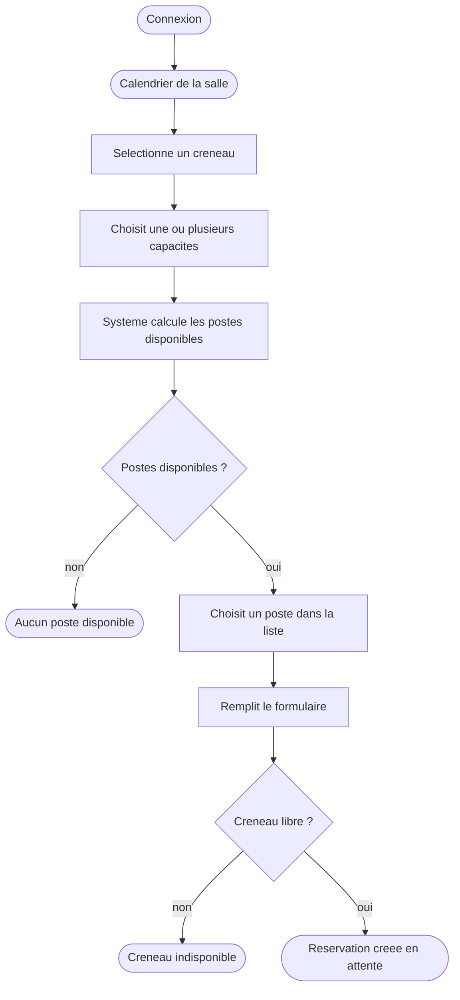
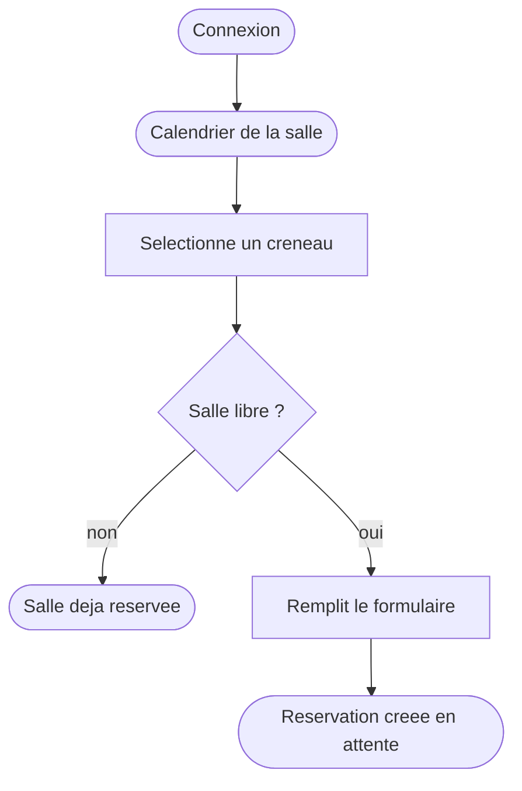
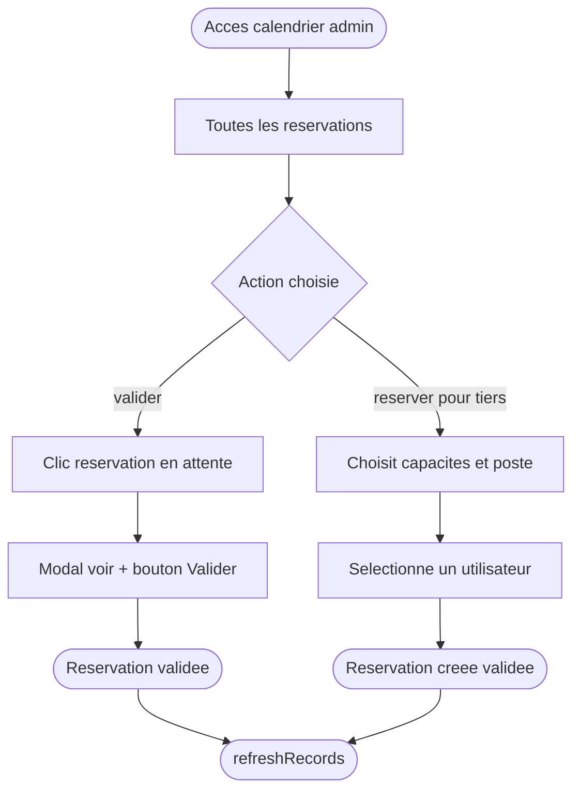

# Module Reservation - Cahier des charges

## Presentation

Le module **Resa** permet la reservation de salles et postes simulateur. Il est integre au serveur **Poseidon** via Skeletor (Laravel + Filament PHP) et utilise **Guava Calendar** pour l'interface calendrier.

---

## Contexte

La Force d'Action Navale dispose de salles de simulation equipees de postes specialises et de salles classiques polyvalentes.

**Salles simulateur** : chaque poste propose des capacites (FPV, 20mm, Bob...). Un utilisateur reserve un creneau en precisant les capacites dont il a besoin — le systeme lui presente les postes compatibles et il choisit.

**Salles classiques** : reservation de la salle entiere sur un creneau. La capacite de la salle (nombre de personnes) est indicative.

---

## Acteurs

| Acteur | Role |
|---|---|
| Visiteur non connecte | Consulte le calendrier en lecture seule |
| Utilisateur connecte | Reserve un creneau selon le mode de la salle |
| Gestionnaire de salle | Valide les reservations de ses salles assignees, cree postes et capacites |
| Admin (`resa::admin`) | Acces complet — toutes les salles, toutes les reservations |

---

## Stack technique

| Couche | Technologie |
|---|---|
| Backend | Skeletor : Laravel + Filament PHP v4 |
| Frontend | Livewire JS + Blade |
| Calendrier | Guava Calendar v2.1.1 CalendarWidget |
| Serveur | Poseidon |
| Base de donnees | MySQL fanlabdb |

---

## Navigation multi-niveaux

```
Demarrage
    │
    ├── Salles avec lieu/unite renseigne ?
    │   │
    │   ├── Plusieurs lieux → Choix du lieu
    │   │       └── Plusieurs unites → Choix de l'unite
    │   │               └── → suite classique
    │   │
    │   └── 1 seul lieu (saute) → 1 seule unite (saute) → suite classique
    │
    └── Suite classique
            ├── 1 seule salle → Calendrier direct
            ├── 1 seul TypeSalle → Liste des salles
            └── Plusieurs TypeSalles → Choix TypeSalle → Liste salles → Calendrier
```

La navigation est resolue automatiquement dans `mount()` via `resoudreNavigation()`.

---

## Deux modes de reservation

### Mode Simulateur

- Calendrier avec colonnes = postes
- Wizard 3 etapes : creneau + capacites → choix poste → infos
- Filtres par poste et capacite disponibles

### Mode Classique

- Calendrier sans colonnes (vue simple)
- Wizard 2 etapes : creneau → infos
- Verification : salle libre sur ce creneau ?
- Un seul occupant a la fois — la capacite est indicative

---

## Parcours utilisateur — Mode Simulateur



### Algorithme de selection du poste

| Poste | Capacites | Score | Libre | Affiche |
|---|---|---|---|---|
| Poste 1 | FPV, 20mm | 2/2 | oui | prioritaire |
| Poste 2 | FPV | 1/2 | oui | partiel manque 20mm |
| Poste 3 | 20mm | 1/2 | oui | partiel manque FPV |
| Poste 4 | FPV, 20mm, Bob | 2/2 | non | non affiche |

Les postes avec score 0 ne sont pas proposes. Si aucun poste n'est disponible, un message d'indisponibilite est affiche.

---

## Parcours utilisateur — Mode Classique



---

## Parcours admin



### Actions disponibles

| Action | Condition |
|---|---|
| Voir le detail | Toujours |
| Valider | `resa::admin` OU gestionnaire de la salle concernee |
| Invalider | Idem |
| Supprimer | En attente uniquement (admin : toujours) |
| Reserver pour un tiers | Permission `resa::reservation.view` |

---

## Regles metier

!!! info "Lecture publique"
    Le calendrier est visible par tous sans connexion. La connexion est requise uniquement pour reserver.

!!! warning "Un user, un creneau"
    Un user ne peut pas avoir deux reservations qui se chevauchent, meme sur des postes differents et meme en mode classique.

!!! warning "Disponibilite par capacite (simulateur)"
    Un poste est propose uniquement s'il est libre ET couvre au moins une des capacites demandees.

!!! success "Admin"
    Une reservation creee par un admin est directement validee avec tracabilite complete `validated_by` et `validated_at`.

- Connexion obligatoire pour reserver
- Un user + un poste + un creneau = une reservation
- Pas de chevauchement possible sur un meme poste
- En mode simulateur : postes tries par score de capacites couvertes
- En mode classique : salle entiere — un seul occupant a la fois
- Reservation user : `validation = 0` en attente admin
- Reservation admin : `validation = 1` directe
- Drag and drop et resize bloques sur les reservations validees sauf admin
- `refreshRecords()` appele apres chaque action

---

## Livrables

- [x] Migrations type_salles, salles, type_postes, salle_postes, type_capacites, poste_capacites, reservations
- [x] Migration unite_id sur salles (lien module RH)
- [x] Migration email sur salles (notification reservation)
- [x] Migration resa_salle_gestionnaires (table pivot user ↔ salle)
- [x] Models Eloquent avec relations et methodes metier
- [x] Seeders de donnees initiales + poste fictif "Salle entiere" pour salles classiques
- [x] CalendrierWidget Guava Calendar — navigation lieu / unite / type_salle / salle
- [x] Mode Simulateur : Wizard 3 etapes + scoring postes
- [x] Mode Classique : Wizard 2 etapes + verification salle libre
- [x] Filtres calendrier par poste et capacite (mode simulateur)
- [x] Blocage visuel creneaux deja reserves (`selectAllow`)
- [x] Resources Filament gestion salles (avec lieu/unite/gestionnaires), postes, capacites, types
- [x] Permissions `resa::admin` et `resa::gestionnaire_salle`
- [x] Policies — gestionnaire limite a ses salles assignees
- [x] Notification email a la creation de reservation (Observer + Mailable)
- [x] Tests Pest 50+ cas
- [x] Documentation technique widget + guide utilisateur

---

## Documents associes

- [Guide utilisateur](guide-utilisateur.md)
- [Schema base de donnees](base-de-donnees.md)
- [Widget calendrier](widget-calendrier.md)
- [Tests](test-unitiaire.md)
