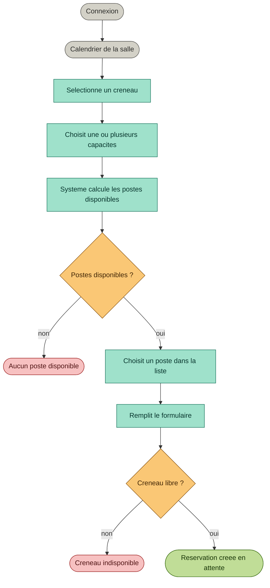
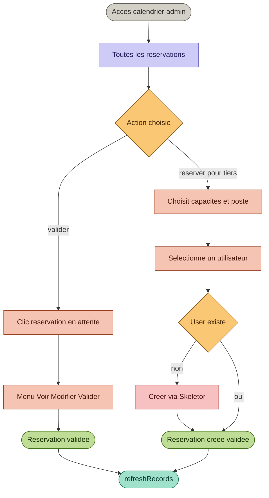

# Module Reservation - Cahier des charges

## Presentation

Le module **Resa** permet la reservation de postes simulateur dans des salles equipees. Il est integre au serveur **Poseidon** via Skeletor (Laravel + Filament PHP) et utilise **Guava Calendar** pour l'interface calendrier.

---

## Contexte

La Force d'Action Navale dispose de salles de simulation equipees de postes specialises. Chaque poste propose un ensemble de **capacites** (FPV, 20mm, Bob...). Un utilisateur reserve un creneau en precisant les capacites dont il a besoin - le systeme lui presente les postes compatibles et disponibles, et il choisit lui-meme.

**Situation actuelle :** une seule salle, 4 postes. L'architecture est prevue pour accueillir de nouvelles salles sans modification structurelle.

---

## Acteurs

| Acteur | Role |
|---|---|
| Visiteur non connecte | Consulte le calendrier en lecture seule |
| Utilisateur connecte | Reserve un creneau en choisissant ses capacites puis son poste |
| Admin | Valide, modifie, cree des reservations pour des tiers |

---

## Stack technique

| Couche | Technologie |
|---|---|
| Backend | Skeletor : Laravel + Filament PHP |
| Frontend | Livewire JS + Blade |
| Calendrier | Guava Calendar CalendarWidget |
| Serveur | Poseidon |
| Base de donnees | MySQL fanlabdb |

---

## Parcours visiteur

Le visiteur accede au calendrier sans connexion.

- Il voit toutes les reservations validees de la salle
- Les colonnes representent les postes
- Les evenements representent les creneaux occupes
- Il ne peut pas reserver - un bouton Se connecter est affiche

---

## Parcours utilisateur connecte

### Algorithme de selection du poste

| Poste | Capacites | Score | Libre | Affiche |
|---|---|---|---|---|
| Poste 1 | FPV, 20mm | 2/2 | oui | prioritaire |
| Poste 2 | FPV | 1/2 | oui | partiel manque 20mm |
| Poste 3 | 20mm | 1/2 | oui | partiel manque FPV |
| Poste 4 | FPV, 20mm, Bob | 2/2 | non | non affiche |

Les postes avec score 0 ne sont pas proposes. Si aucun poste n'est disponible pour les capacites demandees, un message d'indisponibilite est affiche.

---

## Parcours admin

### Actions disponibles

| Action | Condition |
|---|---|
| Voir le detail | Toujours |
| Valider | Permission resa::validation_salle + en attente |
| Invalider | Permission resa::validation_salle + validee |
| Modifier | En attente uniquement |
| Supprimer | En attente uniquement |
| Reserver pour un tiers | Permission resa::reservation.view |

---

## Regles metier

!!! info "Lecture publique"
    Le calendrier est visible par tous sans connexion. La connexion est requise uniquement pour reserver.

!!! warning "Disponibilite par capacite"
    Un poste est propose uniquement s'il est libre ET couvre au moins une des capacites demandees. L'utilisateur choisit lui-meme parmi les options disponibles.

!!! success "Admin"
    Une reservation creee par un admin est directement validee avec tracabilite complete validated_by et validated_at.

- Connexion obligatoire pour reserver
- Un user + un poste + un creneau = une reservation
- Pas de chevauchement possible sur un meme poste
- Les postes sont tries par score de capacites couvertes
- L'utilisateur choisit lui-meme le poste parmi les disponibles
- Les capacites choisies sont sauvegardees en JSON sur la reservation
- Reservation user : validation = 0 en attente admin
- Reservation admin : validation = 1 directe
- Drag and drop et resize bloques sur les reservations validees sauf admin
- refreshRecords appele apres chaque action

---

## Livrables

- [x] Migrations type_salles, salles, type_postes, salle_postes, type_capacites, poste_capacites, reservations
- [x] Models Eloquent avec relations et methodes metier
- [x] Seeders de donnees initiales
- [x] CalendrierWidget Guava Calendar
- [ ] Algorithme de scoring des postes disponibles
- [ ] Formulaire de reservation avec selection capacites et postes
- [ ] Vues Blade calendrier selection poste formulaire
- [ ] Ressource Filament gestion salles postes capacites
- [ ] Documentation technique widget

---

## Documents associes

- [Flux de reservation](index.md)
- [Schema base de donnees](base-de-donnees.md)
- [Widget calendrier](widget-calendrier.md)
